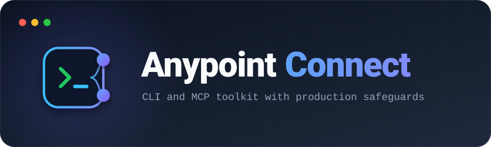

CLI · MCP server · JavaScript library

# Operate Anypoint Platform with safer defaults

Install once, authenticate through your organization’s Connected App, and use the same well-tested client to inspect applications, analyze logs, pull metrics, manage API assets, and perform guarded lifecycle operations.

<a class="anc-button anc-button--primary" href="getting-started/">Set up in about 15 minutes</a>
<a class="anc-button" href="recipes/">See working recipes</a>

<code>npm install --global @sfdxy/anypoint-connect
anc config init
anc auth login
anc auth status</code>

## Choose how you want to use it

<a class="anc-card" href="getting-started/">
Terminal
<h3>Use the CLI</h3>

Best for operators and Mule developers who want copyable commands without writing Node.js.

</a>
<a class="anc-card" href="mcp/">
MCP
<h3>Run the MCP server</h3>

Give an MCP host runtime evidence while credentials and confirmation gates remain local.

</a>
<a class="anc-card" href="library/">
Automation
<h3>Call the library</h3>

Use the same API clients from JavaScript or TypeScript after authenticating a local profile.

</a>

## Credentials, without the mystery

`anypoint-connect` uses a Connected App that **acts on behalf of a user**. The Client ID and Client
Secret identify the app; a browser login authorizes the user; the resulting OAuth tokens are stored
separately and refreshed automatically.

<strong>Connected App</strong>Client ID, Client Secret, redirect URI, Full Access, Background Access

→

<strong>Browser authorization</strong>The user signs in with existing Anypoint permissions and MFA

→

<strong>Local profile</strong>Restricted credential file plus encrypted, refreshable OAuth tokens

[Follow the exact Connected App fields](credentials.md), including what to ask an organization
administrator for and how to rotate a secret safely.

## What it covers

| Area | Typical work |
| --- | --- |
| Runtime Manager | List, inspect, compare across environments, publish and deploy a JAR, redeploy, roll back, restart, scale, stop, start, and delete applications |
| Logs | Tail and download logs, cluster errors with context, find recurring patterns, summarize log health, count lines that leak session or bearer credentials without returning them |
| Monitoring | Traffic, failures, and p50–p99 latency per app, worker, or route; heap, old-generation pressure, GC, CPU, and RAM per worker; incident time series; freeform AMQL. See [Monitoring](monitoring.md) |
| Exchange and Design Center | Search assets, download specifications, preview and sync spec files, publish API and application assets |
| API Manager and Governance | Instances, policies, SLA tiers, alerts, governance rulesets and conformance |
| Alerts | Anypoint Monitoring metric alerts on apps and API instances: list, create, change, enable, disable, delete; Runtime Manager event alerts read only. See [Alerts](alerts.md) |
| Platform services | Environments, entitlements, audit log with platform and user actor classes, Anypoint MQ, and Object Store v2 |

Every MCP tool is listed in the [tool catalog](tools.md); every command is in the
[CLI reference](cli-reference.md).

## Safety is part of the interface

Every application change previews by default. Publishing binds the exact JAR bytes, a change to an
existing app carries only what was asked for and checks the runtime first, secret values never pass
through the conversation, deletion is bound to the deployment ID that was inspected, Design Center writes
need a single-use preview token, and production needs an additional acknowledgement or a user-level
pre-approval bound to the organization and environment. Production takes only jars whose build marker
says production deployable, checked on the artifact actually deployed. Read the [safety model](safety.md) before automating a change.

**Start with a read.** `anc auth status` verifies the local session, and
`anc apps list --env Sandbox` verifies that the intended environment is visible. Authentication,
environment visibility, permissions, and subscription entitlements are separate states with separate fixes.

